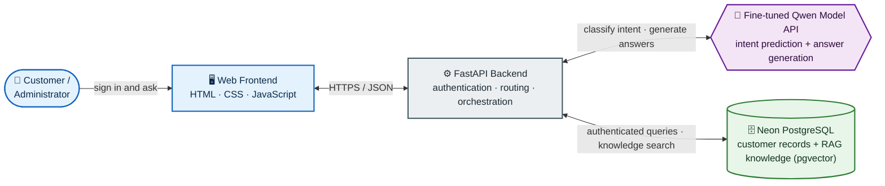
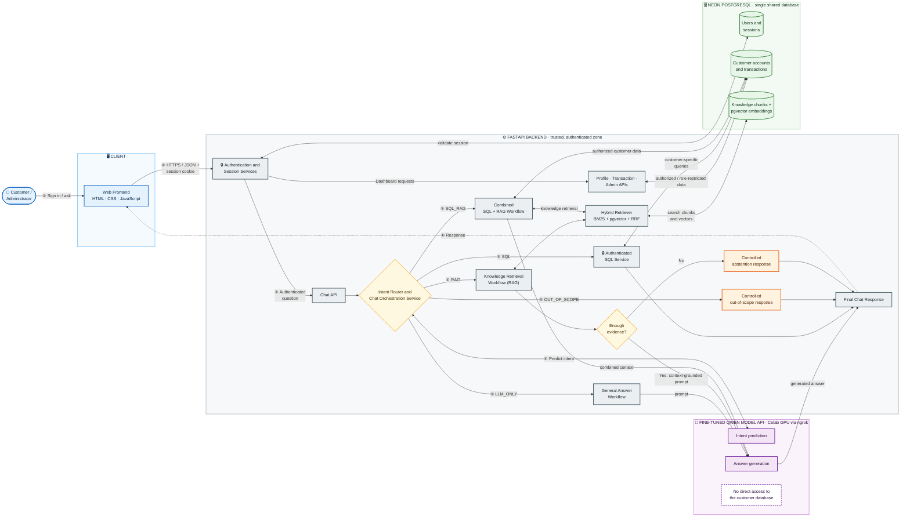
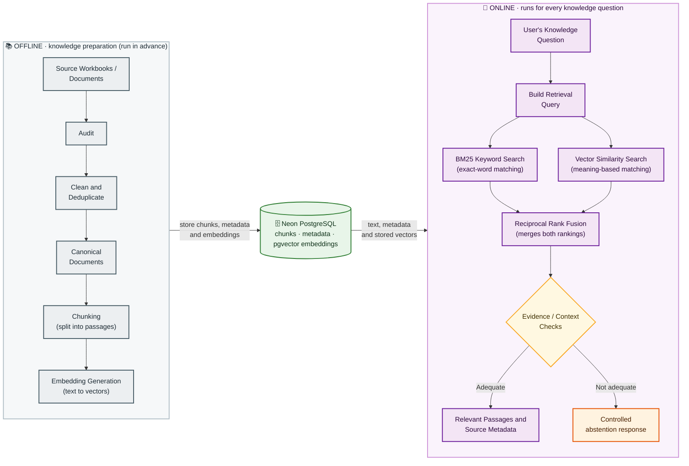
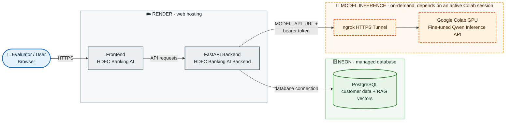
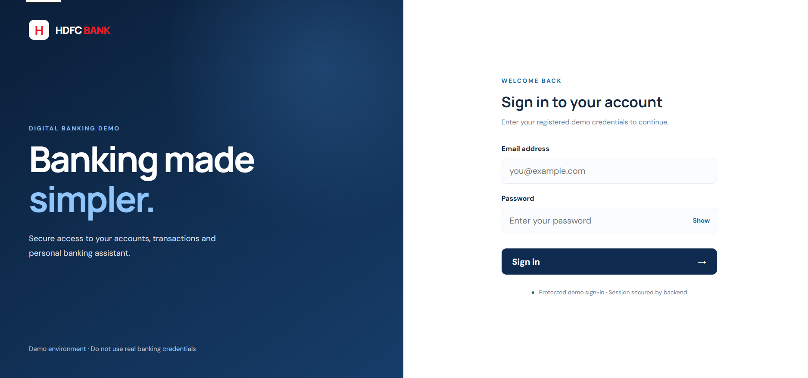
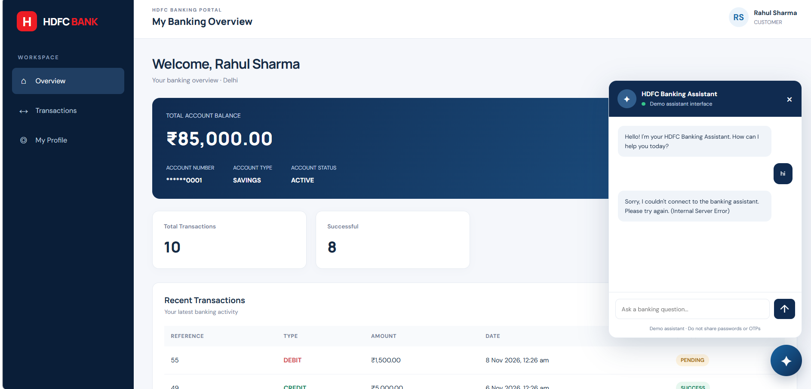
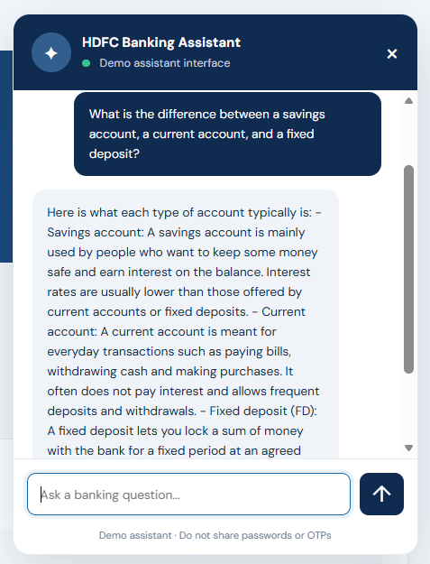
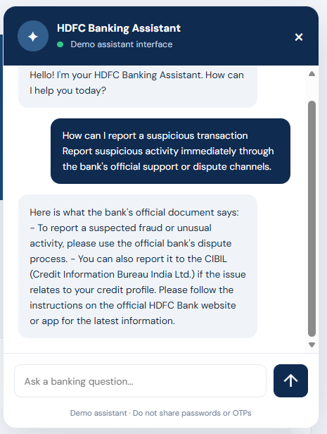
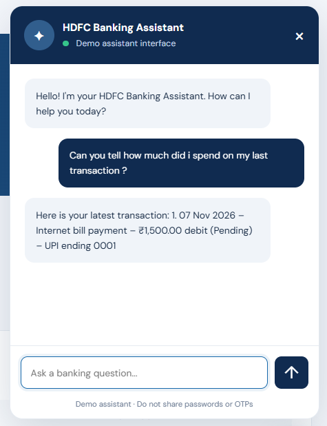
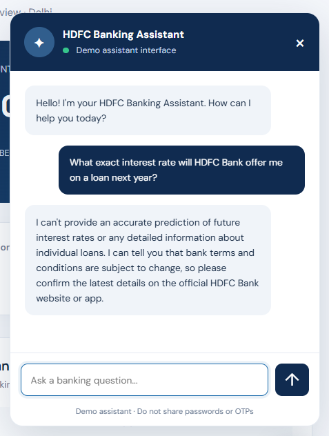

# HDFC Banking AI Assistant

An AI-powered banking portal combining a fine-tuned language model, retrieval-augmented generation (RAG), and authenticated database queries for banking conversations and customer self-service workflows.

**Demonstration Video:** https://drive.google.com/file/d/1nkIYssxBNosMSueRugJvFI4VZIQWkGgO/view?usp=sharing

**Live Website (Backend):** https://hdfc-banking-ai-backend.onrender.com

(Demo Login Credentials: rahul@example.com, Pass: rahuldemo@123)

> **Model API Availability:** The AI inference service runs through a Google Colab GPU session and ngrok tunnel. Its availability depends on the active Colab session. Due to free-tier GPU usage limitations, the session may not be continuously active, and AI-powered features may be temporarily unavailable when it is stopped.

## 1. Business Problem and Product Goal

Banking customers may need help with general banking questions, information contained in banking documents, and their own account or transaction information. These needs involve different data sources and should not all be handled by a single unrestricted language-model response.

This project demonstrates a unified banking-assistant experience that routes requests to an appropriate workflow:
- General banking questions use the language-model response path.
- Knowledge-base questions use retrieval-augmented generation.
- Customer-specific requests use authenticated backend services and database queries.
- Unsupported or insufficiently supported requests can receive a controlled fallback or abstention response.

**Product goal:** Demonstrate how an AI-enabled banking portal can combine language-model interaction, document retrieval, and authenticated structured-data access in one application.

**Intended users:** Demonstration customers using the banking portal and administrators using role-restricted dashboard functions.

## 2. Project Overview and Key Features

The HDFC Banking AI Assistant is a full-stack demonstration application with a browser-based frontend and a FastAPI backend.

### Banking dashboard
- Customer and administrator views.
- Account and transaction summaries.
- Customer profile information.
- Administrative views for customers, accounts, and transactions.

### AI banking assistant
- Natural-language banking queries.
- Intent classification and task routing.
- General banking question answering.
- Responses generated using retrieved or database-provided context where applicable.

### Fine-tuned language model
- A fine-tuned Qwen-based model is called through a separate model inference API.
- The backend uses the model API for intent prediction and answer generation.
- The model API is configured using environment variables; credentials must not be stored in source control.

### Retrieval-augmented generation (RAG)
- Banking knowledge documents are audited, cleaned, curated, and split into chunks.
- Text chunks are converted into embeddings.
- Retrieval combines semantic vector search and keyword search.
- Hybrid rankings are fused using Reciprocal Rank Fusion (RRF).
- Retrieved passages can include source and verification metadata.
- Retrieval/evidence checks can lead to a controlled response when adequate evidence is unavailable.

**Knowledge-base qualification:** The inspected RAG documentation identifies retained knowledge-base records as `DEMO_LABELLED`, not verified official HDFC Bank policy. Treat them as demonstration knowledge, not authoritative or current bank policy.

### Customer database retrieval
- Authenticated users can retrieve their own account and transaction information.
- The backend resolves the customer record from the authenticated user identity.
- Supported operations include account listing, account balance, transaction summaries, recent transactions, failed transactions, and pending transactions.
- Administrator endpoints provide role-restricted views of customer, account, and transaction records.

### Authentication and access control
- Login and registration endpoints.
- Password hashing and verification.
- Session-token authentication using an HTTP-only cookie.
- Role-aware authorization for administrator routes.
- Logout revokes the stored session.

## 3. AI Workflow and Prompt Strategy

The backend uses intent classification and routing to select a processing path instead of sending every request through the same response workflow.

### Request-processing flow
1. The user signs in through the frontend.
2. FastAPI authenticates the user and establishes a server-side session.
3. The chat endpoint receives the question and authenticated user context.
4. The intent router calls the fine-tuned model to predict the request intent and relevant task parameters.
5. The chat service dispatches the request:
   - `LLM_ONLY`: general response generation.
   - `RAG`: retrieve relevant knowledge passages and generate a response using available context.
   - `SQL`: execute a supported customer-specific database operation.
   - `SQL_RAG`: combine customer database information with retrieved knowledge where required.
   - `OUT_OF_SCOPE`: return a controlled response for unsupported topics.
6. The response is returned to the frontend.

### Prompting approach
The model is used for intent prediction and answer generation. The backend determines the workflow and supplies relevant context to the response-generation path. For RAG requests, retrieved passages are supporting context; for customer-specific requests, authenticated backend database services provide structured information.

This separation keeps routing, retrieval, database access, and language generation as distinct responsibilities. The language model is not intended to independently access arbitrary customer records.

### Validation, guardrails, and error handling
- Authentication and role checks protect customer-specific and administrator operations.
- Customer data access is resolved through the authenticated backend identity.
- RAG retrieval uses evidence/context checks before generating a knowledge-grounded response.
- Unsupported or insufficiently supported requests can be handled through controlled fallback or abstention paths.
- API credentials are supplied through environment variables rather than committed to source control.

The available evaluation notes identify areas needing improvement, including personal-data abstention testing. The project therefore relies on authenticated backend/database authorization for personal customer data and does not treat RAG as an authorization mechanism.

## 4. Data Sources and Tool Integration

### Data and storage
- **Banking knowledge documents:** Prepared through the project's audit, cleaning, deduplication, canonicalization, chunking, and embedding workflow. The retained records are demonstration-labelled.
- **Customer and banking records:** Stored in the project's Neon PostgreSQL database and accessed through backend services after authentication.
- **RAG document chunks and vector representations:** Stored in the same Neon PostgreSQL database, with `pgvector` providing vector storage and similarity search. The inspected retrieval evaluation configuration uses `BAAI/bge-small-en-v1.5` embeddings (384 dimensions).

### Main integrations

| Component | Responsibility |
|---|---|
| Fine-tuned Qwen model API | Intent prediction and answer generation |
| FastAPI services | Request handling, routing, authentication, orchestration |
| Neon PostgreSQL | Central managed PostgreSQL database for customer records and RAG knowledge data |
| pgvector (Neon PostgreSQL extension) | Embedding storage and vector similarity retrieval within the same database |
| BM25 retrieval | Keyword-based retrieval |
| Hybrid retrieval / RRF | Combines keyword and vector retrieval rankings |
| Render | Hosts the deployed frontend and backend services |
| Google Colab GPU + ngrok | Separate model-inference environment and tunnel used by the deployed backend |

The frontend sends requests to the backend API. The backend authenticates the user, routes the request, and invokes the relevant model, retrieval, or database service. The resulting response is returned to the frontend. The model API is configured through `MODEL_API_URL` and `MODEL_API_TOKEN`; database configuration is supplied through the environment variables expected by the backend.

## 5. System Architecture

The architecture has two connected flows:

1. **Online request flow:** a signed-in user sends a request through the frontend. The FastAPI backend authenticates the request, asks the fine-tuned Qwen model to classify its intent, and sends it to the appropriate workflow.
2. **Knowledge preparation flow:** banking knowledge documents are prepared separately, converted into chunks and embeddings, and stored in the same Neon PostgreSQL database used by the application. At runtime, the RAG workflow searches this stored knowledge.

### System at a glance

A one-look summary of the five main parts of the system. The detailed views below zoom into each part.



### End-to-end application workflow



**Example questions and the path each one takes:**

| Example question | Predicted intent | Path |
|---|---|---|
| "What is compound interest?" | `LLM_ONLY` | Intent Router → General Answer Workflow → Qwen answer generation → response |
| "What does the knowledge base say about this policy?" | `RAG` | Intent Router → Knowledge Retrieval → evidence check → Qwen answer generation → response (or abstention if evidence is insufficient) |
| "What is my account balance?" | `SQL` | Intent Router → Authenticated SQL Service → customer tables → response |
| "Show my failed transactions and explain the related policy." | `SQL_RAG` | Intent Router → Combined SQL + RAG Workflow → customer tables and knowledge search → Qwen answer generation → response |
| "What is the weather today?" | `OUT_OF_SCOPE` | Intent Router → controlled out-of-scope response |

### Knowledge-base preparation and runtime retrieval

This is a separate data-preparation flow. It populates the knowledge data that the online RAG workflow searches; it is not a step that runs from the user's question each time.



### How each request is processed

| Predicted intent | Processing path |
|---|---|
| `LLM_ONLY` | The backend sends the general question to the Qwen model for answer generation. |
| `RAG` | The backend retrieves relevant knowledge passages using BM25 and pgvector hybrid retrieval, then uses the retrieved context for answer generation. |
| `SQL` | The backend runs the supported customer-specific database operation using the authenticated user's identity. |
| `SQL_RAG` | The workflow combines the required authenticated database information and retrieved knowledge context. |
| `OUT_OF_SCOPE` | The backend returns a controlled response for an unsupported request. |

The Qwen model API is used for intent prediction and answer generation. It does not directly query the customer database. Customer-specific SQL operations remain in authenticated backend services, while the RAG workflow searches the knowledge documents and embeddings stored in Neon PostgreSQL.

### Why this architecture was chosen

The project separates the user interface, backend orchestration, model inference, retrieval, and structured-data access. This gives each component a distinct responsibility. Keeping customer-specific SQL operations in authenticated backend services avoids relying on a language model as the access-control layer.

A separate model-inference endpoint allows the fine-tuned model to run in a GPU-enabled environment without requiring the web backend host to load the model itself. The trade-off is dependence on the separate inference service and its tunnel being available.

## 6. Deployment Architecture

The current demonstration deployment uses separate services:



- **Live frontend:** https://hdfc-banking-ai.onrender.com
- **Backend service:** https://hdfc-banking-ai-backend.onrender.com
- **Model inference:** Google Colab GPU service exposed through ngrok.
- **Configuration:** The backend uses `MODEL_API_URL` and `MODEL_API_TOKEN` for the model API connection.

### Demo Login Credentials

Use the following credentials to explore the application:

- **Email:** rahul@example.com
- **Password:** rahuldemo@123

**Note:** These are demo credentials intended only for project evaluation.

The model inference service is separate from the Render frontend and backend. Its availability depends on the Colab runtime and ngrok tunnel being active. If the tunnel URL or token changes, update the corresponding backend environment variables securely.

## 7. Technology Stack

| Layer | Technologies |
|---|---|
| Frontend | HTML, CSS, JavaScript |
| Backend API | Python, FastAPI |
| Database access | SQLAlchemy |
| Database | Neon PostgreSQL |
| Vector storage and search | pgvector extension in Neon PostgreSQL |
| AI model | Fine-tuned Qwen-based model |
| Fine-tuning artifacts | QLoRA/LoRA adapter files are present in the project structure |
| RAG embeddings | `BAAI/bge-small-en-v1.5` (384 dimensions in the inspected evaluation artifacts) |
| Retrieval | BM25 keyword retrieval, vector retrieval, Reciprocal Rank Fusion |
| Deployment | Render, Google Colab GPU, ngrok |

## 8. Screenshots

The following screenshots show the deployed application's interface and representative chatbot workflows.

### Application interface

| Screenshot | Description |
|---|---|
|  | Home page and application entry point |
|  | Banking dashboard interface |

### AI assistant capabilities

| Screenshot | Description |
|---|---|
|  | General banking question and answer |
|  | Knowledge-base retrieval demonstration |
|  | Customer-specific database retrieval |
|  | Handling a question that cannot be answered reliably from available information |

### 9.1 Fine-Tuning and Model Evaluation

The HDFC Banking AI Assistant uses a fine-tuned `Qwen/Qwen2.5-1.5B-Instruct` model for intent classification and structured response generation. The model was fine-tuned using QLoRA with 4-bit quantization and LoRA adapters.

#### Dataset

The fine-tuning dataset was divided into three splits:

| Dataset Split | Number of Records |
|---|---:|
| Training | 5,470 |
| Validation | 776 |
| Testing | 880 |
| **Total** | **7,126** |

The dataset contains examples for the following processing stages:

- `ROUTER` – Intent classification and request routing.
- `ROUTER_FOLLOWUP` – Handling follow-up interactions.
- `ANSWER` – Generating structured responses.

#### Fine-Tuning Configuration

| Parameter | Configuration |
|---|---|
| Base Model | `Qwen/Qwen2.5-1.5B-Instruct` |
| Fine-Tuning Method | QLoRA |
| Quantization | 4-bit NF4 with double quantization |
| LoRA Rank (`r`) | 16 |
| LoRA Alpha | 32 |
| LoRA Dropout | 0.05 |
| Target Modules | `q_proj`, `k_proj`, `v_proj`, `o_proj`, `gate_proj`, `up_proj`, `down_proj` |
| Training Epochs | 2 |
| Learning Rate | 0.0001 |
| Optimizer | Paged AdamW 8-bit |
| Learning Rate Scheduler | Cosine |
| Effective Batch Size | 16 |
| Gradient Checkpointing | Enabled |
| Mixed Precision | FP16 |

#### Training Performance

The model completed two training epochs, with validation performed at 100-step intervals.

| Step | Training Loss | Validation Loss |
|---:|---:|---:|
| 100 | 0.049600 | 0.092337 |
| 200 | 0.024800 | 0.058254 |
| 300 | 0.007700 | 0.040761 |
| 400 | 0.009000 | 0.040437 |
| 500 | 0.003900 | 0.037352 |
| 600 | 0.003900 | 0.037188 |

**Final training loss:** 0.04736

#### Intent Classification Evaluation

Intent classification was evaluated using a balanced sample of 100 records selected from the 625 `ROUTER` examples in the test dataset. The sample contained 20 examples for each intent category.

| Intent | Precision | Recall | F1-Score | Support |
|---|---:|---:|---:|---:|
| `LLM_ONLY` | 0.95 | 1.00 | 0.98 | 20 |
| `OUT_OF_SCOPE` | 1.00 | 0.95 | 0.97 | 20 |
| `RAG` | 1.00 | 1.00 | 1.00 | 20 |
| `SQL` | 0.83 | 1.00 | 0.91 | 20 |
| `SQL_RAG` | 1.00 | 0.80 | 0.89 | 20 |
| **Macro Average** | **0.96** | **0.95** | **0.95** | **100** |
| **Weighted Average** | **0.96** | **0.95** | **0.95** | **100** |

The evaluation produced the following results:

| Evaluation Metric | Result |
|---|---:|
| Intent Classification Accuracy | **95%** |
| Exact JSON Accuracy | **93%** |

Exact JSON accuracy measures whether the generated structured output matched the expected JSON response, including its fields and values.

These results represent the balanced router sample evaluated in the fine-tuning notebook. They are separate from the RAG retrieval evaluation results presented below.

## 9.2 RAG Evaluation and Reliability

The repository's inspected evaluation artifacts report a 29-question test sample for the `BAAI/bge-small-en-v1.5` retrieval configuration.

| Metric | Reported result |
|---|---:|
| Hybrid Recall@5 | 0.552 |
| Hybrid MRR | 0.503 |
| Answerable-question pass rate | 0.931 |
| False abstention rate | 0.069 |
| Absent-answer abstention | 0.917 |

### Evaluation notes and limitations
- The evaluation sample contains 29 questions; it is small and is not production-level validation.
- The accompanying evaluation notes state that the questions were model-drafted and were not accompanied by a completed independent human-review decision file.
- The evaluation notes identify a personal-data abstention weakness in one of two tested personal-data questions. Personal and account-specific data must therefore continue to use authenticated backend/database authorization rather than RAG.
- The knowledge-base records are labelled as demonstration knowledge and must not be represented as verified current HDFC Bank policy.
- These metrics describe retrieval/evaluation artifacts, not a guarantee of end-to-end answer accuracy.

The retrieval evaluation provides an initial indication of whether relevant knowledge passages are returned near the top of ranked results and whether the retrieval workflow distinguishes answerable from absent-answer questions in this small test sample. It does not independently establish the correctness of every generated answer or the reliability of the deployed application.

### Known limitations
- The retrieval evaluation set is small and lacks completed independent human-review validation.
- The knowledge base is demonstration-labelled rather than verified current bank policy.
- Personal-data abstention requires further testing; authenticated backend authorization remains essential.
- The separately hosted model inference service depends on the Colab runtime and ngrok tunnel.
- End-to-end answer quality and deployment reliability require continued testing across more use cases.

## 10. Project Structure

The following tree summarizes the main application components.

```text
hdfc-banking-ai/
├── backend/
│   ├── app/
│   │   ├── api/routes/       # Authentication, chat, profile, transactions, admin
│   │   ├── core/             # Security and authentication dependencies
│   │   ├── database/         # Database connection and models
│   │   ├── schemas/          # Request/response schemas
│   │   └── services/         # Chat orchestration, routing, SQL, model and RAG services
│   ├── models/               # Fine-tuning adapter/model artifacts, if included
│   ├── rag/                  # RAG data, ingestion, retrieval and evaluation
│   ├── tests/                # Backend tests
│   └── requirements.txt
├── database/
│   ├── migrations/
│   ├── seed/
│   └── schema.sql
├── frontend/
│   ├── index.html
│   └── style.css
├── Screenshots/
├── README.md
└── architecture.mmd
```

## 11. Local Setup

### Prerequisites
- Python version supported by the project's dependencies.
- A Neon PostgreSQL database configured for the application, with the required `pgvector` extension enabled.
- Access to the configured model inference API for AI chat features.

### 1. Clone the repository

```bash
git clone <YOUR_GITHUB_REPOSITORY_URL>
cd hdfc-banking-ai
```

### 2. Create and activate a virtual environment

Windows PowerShell:

```powershell
py -m venv .venv
.\.venv\Scripts\Activate.ps1
```

macOS / Linux:

```bash
python3 -m venv .venv
source .venv/bin/activate
```

### 3. Install backend dependencies

```bash
pip install -r backend/requirements.txt
```

### 4. Configure environment variables

Create a local environment file using the variable names expected by the backend. The model API settings include:
- `MODEL_API_URL`
- `MODEL_API_TOKEN`

Configure the database connection using the exact variable name expected by the project's database configuration. Refer to the backend configuration and any `.env.example` file for the complete list.

Never commit `.env` files, API tokens, database passwords, or other secrets.

### 5. Prepare the database

Configure the Neon PostgreSQL connection using the database environment variable expected by the backend. Ensure the `pgvector` extension and the project's database schema are available. Customer tables and RAG document/vector records are stored in this same Neon database. The RAG retrieval configuration must use the same embedding model as the vectors stored in the knowledge base.

### 6. Run the backend

From the `backend` directory:

```bash
uvicorn app.main:app --reload
```

Open the local application at:

```text
http://127.0.0.1:8000
```

The FastAPI application may serve the frontend static files in the local setup, while the deployed frontend is hosted as a separate Render service. Follow the actual deployment configuration when testing the live services.

## 12. API Overview

The backend defines the following route groups:

| Route prefix | Purpose |
|---|---|
| `/api/auth` | Login, registration and logout |
| `/api/chat` | Authenticated chatbot requests |
| `/api/profile` | Current user's profile |
| `/api/transactions` | Current user's account and transaction data |
| `/api/admin` | Role-protected administrative data and dashboard |

Interactive API documentation is available at `/docs` when the backend is running, if enabled in the application configuration.

## 13. Security and Responsible Use

- Customer-specific queries are tied to the authenticated user identity in the backend.
- Administrative endpoints use role-based authorization.
- Session tokens are stored in HTTP-only cookies and session records are revocable.
- Secrets and credentials must be supplied through environment variables and excluded from Git.
- The RAG knowledge base contains demonstration-labelled records; it is not an authoritative source of current HDFC Bank policy.
- Use only demonstration accounts and non-sensitive sample data in recordings and public demonstrations.
- This project is for academic demonstration and testing. It must not be used to make real financial decisions or process real customer banking activity.

## 14. Future Improvements

- Improve RAG retrieval quality and expand the independently reviewed evaluation set.
- Strengthen personal-data and unsupported-query abstention tests.
- Add more robust model-serving availability and monitoring.
- Expand automated end-to-end testing across authentication, routing, retrieval and answer generation.
- Add source-level traceability and freshness checks for the knowledge base.
- Record latency and operational cost measurements across representative workflows.

## Acknowledgements

Developed as an academic team project exploring the integration of large language models, fine-tuning, retrieval-augmented generation, backend APIs, and relational database retrieval in a banking-assistant demonstration.
